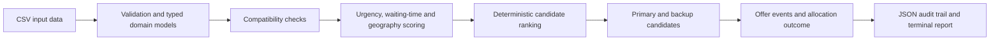

# T100-PS-127 - Organ Transplant Waitlist Allocation Engine

> An offline, deterministic academic simulation of regional deceased-donor organ allocation. It is **not clinically validated** and must never be used for real transplant decisions.

## Project overview

This capstone project simulates how a regional organ-sharing network can evaluate a deceased-donor organ offer. It validates candidate eligibility, calculates organ-specific priority, ranks candidates predictably, selects primary and backup candidates, and saves an audit trail explaining every decision.

The project focuses on kidney, liver, and heart allocation. It is designed for transparent demonstrations: the terminal tells the user who ranked first, why they ranked first, who the backups are, and why other candidates were excluded.

## Team

- Sharathkumar - 1AT24IS175
- Shashidhar Tiwari - 1AT24IS176
- Section ISE D

## How the system works



For each donor offer, the engine follows this workflow:

1. Load the donor, candidate, hospital, transport, status, and refusal records.
2. Skip candidates who are inactive, deceased, delisted, transplanted, or clinically stale.
3. Exclude incompatible candidates using blood group, age/size, transport, and cold-ischemia checks.
4. Calculate waiting time, HLA mismatches, organ-specific urgency, score components, and geographic tier.
5. Apply urgency overrides, tier ordering, score ordering, and documented tie-breaks.
6. Select one primary candidate and up to two backups.
7. Store the candidate snapshot, score breakdown, exclusion reasons, rank, and outcome in a reproducible audit file.

## Business rules implemented

- **BR-01:** Blood-group compatibility and identical-group priority.
- **BR-02:** Kidney, liver, and heart urgency/scoring policies.
- **BR-03:** Historical active waiting-time calculation excluding inactive periods.
- **BR-04:** Hospital/city/zone tiers and cold-ischemia deadlines.
- **BR-05:** Heart/liver size matching, paediatric priority support, and older-donor consent.
- **BR-06:** Explicit deterministic tie-break order.
- **BR-07:** Event-driven offer windows, timeouts, and refusal-penalty policy.
- **BR-08:** Primary and two backup candidates.
- **BR-09:** Atomic liver-kidney multi-organ allocation support.
- **BR-10:** Lifecycle status and stale clinical-update handling.
- **BR-11:** Canonical JSON audits and replay retrieval.
- **BR-12:** Explicit rule-precedence pipeline.

## What is included

```text
src/allocation_engine/   Core Python models, rules, storage, engine, CLI and reporting
data/sample/             Integrated 250-candidate supplied sample dataset
data/official/           Original supplied data pack preserved verbatim
data/synthetic/          Reproducible generated development dataset
tests/                   Pytest unit, boundary, validation and sample-pack tests
docs/                    Architecture, decision log, traceability, viva and demo materials
commands/                Non-interactive command-file example
outputs/match_runs/      Generated JSON audits (ignored by Git)
```

### Input data used

The supplied sample pack contains 250 waitlisted candidates, 20 deceased-donor offers, 12 hospitals, 144 transport routes, historical status intervals, historical refusals, and an ordered event-command stream. All records are demonstration data for this academic project.

The engine also includes a seeded synthetic dataset generator for safe development without relying on real patient information.

## Quick start

Python 3.10+ is required.

```powershell
git clone https://github.com/syedibad52/T100-PS-127.git
cd T100-PS-127
python -m pip install -r requirements.txt
```

Validate the supplied sample pack:

```powershell
python main.py validate --data-dir data/sample
```

Run the recommended recruiter demonstration - a liver offer with a super-urgent liver-kidney candidate:

```powershell
python main.py match --data-dir data/sample --donor OFR-001 --as-of 2026-08-03T05:00:00 --run-id DEMO_MULTI
```

The terminal then displays donor details, the primary candidate, two backups, the top five candidates, score components, and the most common exclusion reasons. In this scenario, `CND-0201` ranks first because of MELD 40, super-urgent status, and eligible liver-kidney multi-organ priority.

Reload a saved human-readable report:

```powershell
python main.py report --run-id DEMO_MULTI
```

Add `--json` to `match`, `report`, or `replay` only when the complete machine-readable audit is needed.

## Useful demo commands

```powershell
# Validate all input relationships before allocation
python main.py validate --data-dir data/sample

# Multi-organ liver and kidney scenario
python main.py match --data-dir data/sample --donor OFR-001 --as-of 2026-08-03T05:00:00 --run-id DEMO_MULTI

# Heart cold-ischemia boundary scenario
python main.py match --data-dir data/sample --donor OFR-005 --as-of 2026-08-17T04:35:00 --run-id DEMO_HEART

# Deterministic ranking/tie-break scenario
python main.py match --data-dir data/sample --donor OFR-006 --as-of 2026-08-24T02:30:00 --run-id DEMO_TIE

# Run the complete automated test suite
python -m pytest -v
```

## Testing

The test suite currently includes 22 automated tests covering all stated assignment edge cases, input validation, deterministic sorting, duplicate-allocation prevention, replay retrieval, and the supplied sample-pack integration. Run it with:

```powershell
python -m pytest -v
```

## Documentation

- [Architecture](docs/architecture.md)
- [Business-rule registry](docs/business_rules.md)
- [Decision log](docs/decision_log.md)
- [Traceability matrix](docs/traceability_matrix.md)
- [Data dictionary](docs/data_dictionary.md)
- [Viva guide](docs/viva_guide.md)
- [Five-minute demo script](docs/demo_script.md)
- [Design document PDF](docs/design_document.pdf)

## Current limitations and status

The supplied evaluation-style pack has been integrated, but visible expected outputs were not supplied. Therefore final evaluator-format compatibility remains pending. The ordered source event stream is preserved as an integration fixture; complete replay of every clinical/status event into evaluation CSV outputs remains the next implementation task. The optional dashboard is intentionally deferred so the CLI engine, rule transparency, and testing remain the priority.
